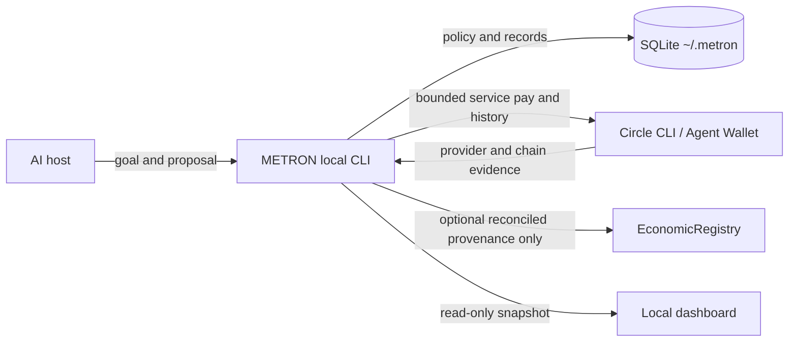

# METRON

**An economic control layer for AI agents.** METRON gives a host agent a revenue goal and bounded operating budget, then records payment evidence and deterministic double-entry accounting in local SQLite.

> An agent should earn the right to spend more capital by proving that previous spending generated revenue.

METRON is a chat-operated local plugin with four skills. `metron-policy` owns economic decisions and the finance CLI; `metron-email` operates customer conversations through the host's connected email and discovery tools; `metron-invoice` renders private PDFs from posted invoice data; and `metron-payment` guides Circle verification and reconciliation. METRON's Python runtime and SQLite state run locally; Circle CLI must be callable by that runtime. The Circle adapter can bridge WSL to a visible Windows CLI. Codex interactive chat is the verified workflow; ChatGPT desktop is configured for local execution but still needs a clean install test. Browser/cloud ChatGPT and other hosts are not verified. METRON does not bundle email transport, host an LLM, provide an MCP server, or run a remote backend.



## Current verification

Circle Terms are never inferred from METRON use; see [Circle setup](docs/INSTALL.md#set-up-circle-agent-wallet-with-your-ai-agent) for the one-time explicit consent flow. Payment execution requires an authenticated Circle Agent Wallet and current Circle evidence. EconomicRegistry is METRON's shared non-custodial provenance contract on Arc Testnet at `0x547552585d8d995c5063820b2950e0db52b4cab4`. Contract deployment and read-only verification are not payment evidence. Synthetic fixtures do not prove live-provider behavior; testnet and synthetic records must remain labeled as such.

The [current E2E and submission evidence](docs/SUBMISSION.md) distinguishes the verified Arc Testnet customer workflow from post-revenue service purchases and public-hackathon requirements. The pilot buyer is a test scenario, not an independent customer; testnet receipts are not mainnet revenue.

## Chat-first setup

You install METRON yourself in ChatGPT desktop: open Plugins, choose **Add marketplace from a repository**, add `riyannode/metronarc` at ref `master`, then install and enable the plugin. The repository is private, so your GitHub account must already have access. Use a local chat thread; the plugin requires desktop local execution to reach Circle CLI and `~/.metron/`.

Start with **“Use METRON. Show status.”** Then ask the agent to check Circle wallet readiness. After setup, you can say **“Use METRON. Help me create a revenue goal and configure my financial policy.”** Review every value before saving. This prompt does not approve a deal or payment.

Set up Circle CLI once where METRON's local runtime can call it. In WSL, check the existing Windows CLI bridge before installing another copy. The official installation and Circle Agent Wallet onboarding steps are in [Getting Started](docs/INSTALL.md), including Windows and WSL checks, Terms consent, local OTP prompt, existing-wallet check, and Arc Testnet session.

The current pilot's final deal and escalated-spend approvals are direct operator instructions in interactive Codex chat. Do not treat a remote ChatGPT thread as able to inspect local state or provide those verified approval steps.

## Developer CLI quickstart

These Python commands are for developers and local troubleshooting. Business users should ask the agent in chat instead. Requirements: Python 3.11+, Circle CLI for provider operations, Bun for private invoice PDF rendering, and Foundry for optional contract build/tests.

```sh
python3 -B skills/metron-policy/scripts/run.py init
python3 -B skills/metron-policy/scripts/run.py status
```

Create a goal from a JSON file. Supply the target and explicitly choose the operating budget, per-action and daily spend caps, minimum wallet balance, minimum deal amount, and reinvestment share. USDC amounts are exact decimal strings; `reinvestment_bps` is an integer from 0 to 10,000. Goal creation does not apply monetary or reinvestment defaults.

```sh
python3 -B skills/metron-policy/scripts/run.py goal-create --input goal.json
```

All runtime state is stored under `~/.metron/`, outside the plugin source/cache. The read-only dashboard is generated at `~/.metron/dashboard.html`; it is a local snapshot, not an interactive control panel in ChatGPT. Ask **“Open my METRON dashboard.”** to open the existing snapshot through the plugin.

### Future npm bootstrap

Bootstrap CLI prepared for npm publication. After the package is published, run `npx @riyannode/metron`. The npm package only registers the GitHub marketplace and prints setup steps; the canonical plugin remains in this repository. This command is not available until npm publication.

METRON is distributed as version `0.2.0` with four skills. Read-only persistence was verified in a genuinely new Codex task with the installed plugin. A clean ChatGPT desktop installation and local-thread run remain a separate acceptance check; a new Python process alone is not a fresh-session test.

## Accounting semantics

A Circle transaction is evidence. A Payment Entry is the business payment. A Journal Entry is its accounting consequence. METRON does not mark an invoice paid from a pasted hash or a submission response. Incoming USDC must be confirmed by Circle, match the open invoice and configured wallet, and be consumed only once.

Circle Agent Wallet is the sole operating-money account. Fund that wallet directly. METRON checks its live USDC balance before dispatch and requires the approved maximum cost plus `minimum_wallet_balance` to remain available. Local policy is deterministic but runs on the local machine.

EconomicRegistry is METRON's shared non-custodial provenance contract on Arc Testnet at `0x547552585d8d995c5063820b2950e0db52b4cab4` (chain ID `5042002`). One spend can link multiple distinct revenue settlements. METRON records only after local reconciliation; Circle remains payment authority and local SQLite/journal remain business truth. Revenue evidence hashes remain unique within each wallet namespace. Registry failure never reverses reconciled accounting or changes Circle settlement status. Users do not deploy or fund the shared registry.

Circle's authoritative settlement record supplies `payment_evidence.tx_hash` when an actual Arc transaction hash is available. METRON preserves that hash as the settlement reference that can be checked in the Arc explorer; a provider/transfer ID remains `provider_ref` and is not promoted to a fabricated transaction hash. Registry commitments use versioned, domain-separated SHA-256 hashes over canonical UTF-8 JSON. Spend-to-revenue attribution is optional and must be supplied explicitly when creating a deal; the referenced spend must belong to the same goal and have confirmed, journaled Circle evidence before a revenue commitment is queued. The external revenue evidence hash excludes all local business IDs, so the same Circle settlement has one stable evidence identity. See [Architecture](docs/ARCHITECTURE.md) for the exact preimages and recovery behavior.

Expected value is not required to authorize an x402 spend. Hard spending limits control authorization: exceeding `max_spend_per_action` escalates, while exceeding `max_daily_spend` or available seed-plus-earned operating capital denies; human approval cannot bypass those absolute caps. The live wallet balance must also cover the approved maximum plus `minimum_wallet_balance` immediately before dispatch. Spend `ALLOW` is automatically persisted as `APPROVED`; `ESCALATE` requires explicit persisted human approval, and `DENY` is terminal.

Realized ROI is calculated only after outcomes are recorded, from confirmed outgoing x402 Payment Entries and reconciled incoming customer Payment Entries for PAID invoices belonging to the goal. Its formula is `(reconciled collected revenue - confirmed spend) / confirmed spend`; it is undefined when confirmed spend is zero. Expected value, quoted deal amounts, open invoices, customer promises, unconfirmed payments, and registry state are not used.

Below-minimum deals, deals marked `custom_or_legal_terms: true`, and nonstandard deal terms require a pre-acceptance exception decision. Standard invoice fields do not by themselves count as custom/legal terms. Customer acceptance always moves the deal to `PENDING_HUMAN`; for the Arc Testnet pilot, the interactive run waits for the operator's direct Codex chat instruction naming that deal before applying final approval. Scheduled runs never initiate `deal-approve` or `spend-approve`. This instruction-based process is not production-grade authorization because the agent and operator share local CLI and SQLite access.

After that final approval, the local finance CLI creates and posts one invoice per deal. The `metron-invoice` skill renders the persisted invoice to a private PDF; `metron-email` can deliver it in the existing customer thread using durable invoice-specific send state. See [Invoice documents](docs/INVOICES.md) for the required branding configuration and idempotency behavior.

## Scope and limitations

- Circle Agent Wallet and Circle CLI are the only implemented payment provider.
- Paid-service execution supports `exact` and `GatewayWalletBatched` x402 on Arc Testnet. Gateway transfers are recorded only after Circle's authoritative transfer API reports `confirmed` or `completed`.
- Circle CLI automatically prefers a Gateway-batched option when the seller and Gateway balance support it. METRON records the rail returned by Circle and reconciles it through the matching authoritative source; a rail mismatch remains `UNKNOWN` and is never retried automatically.
- The default chain is `ARC-TESTNET`; change it only through an explicit local configuration step after verifying the target chain.
- Circle OTP login, wallet funding, and testnet service payment require the wallet owner's account actions. Routine customer email runs through the connected host account without an extra approval gate. Users do not deploy or fund a METRON contract.
- Testnet transaction evidence does not prove mainnet readiness or business truth.
- Customer outreach and replies are performed by `metron-email` through the host's connected email tools; METRON has no bundled email transport.
- METRON has no hosted service, agent, scheduler, dashboard write controls, or arbitrary contract executor. The user configures scheduler frequency in the host.

See [installation](docs/INSTALL.md), [privacy policy](docs/PRIVACY.md), [security boundaries](docs/SECURITY.md), [architecture](docs/ARCHITECTURE.md), and [demo flow](docs/DEMO.md).
