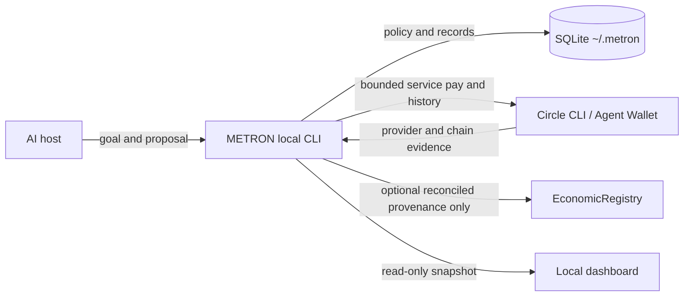

# METRON

**An economic control layer for AI agents.** METRON gives a host agent a revenue goal and bounded operating budget, then records payment evidence and deterministic double-entry accounting in local SQLite.

> An agent should earn the right to spend more capital by proving that previous spending generated revenue.

METRON is a skill-first plugin for Codex and compatible local AI hosts. The host supplies reasoning, search, browser, and email connections. METRON supplies local economic state and policy. It does not host an LLM, email integration, MCP server, or remote backend.



## Current verification

Circle Terms are never inferred from METRON use; see [Circle setup](docs/INSTALL.md#circle-setup) for the one-time explicit consent flow. Payment execution requires an authenticated Circle Agent Wallet and current Circle evidence. EconomicRegistry is METRON's shared non-custodial provenance contract on Arc Testnet at `0x547552585d8d995c5063820b2950e0db52b4cab4`. Contract deployment and read-only verification are not payment evidence. Synthetic fixtures do not prove live-provider behavior; testnet and synthetic records must remain labeled as such.

## Local quickstart

Requirements: Python 3.11+, Circle CLI for provider operations, and Foundry for contract build/tests.

```sh
python3 -B skills/metron/scripts/run.py init
python3 -B skills/metron/scripts/run.py status
```

Create a goal from a JSON file (amounts are exact USDC decimal strings):

```json
{
  "revenue_target": "2000",
  "policy": {
    "operating_budget": "20",
    "max_spend_per_action": "0.10",
    "max_daily_spend": "2",
    "minimum_wallet_balance": "10",
    "reinvestment_bps": 1000,
    "minimum_deal": "450"
  }
}
```

```sh
python3 -B skills/metron/scripts/run.py goal-create --input goal.json
```

All runtime state is stored under `~/.metron/`, outside the plugin source/cache. The read-only dashboard is generated at `~/.metron/dashboard.html` and shows the active goal, collected revenue, confirmed spend, net contribution, realized ROI, earned operating capital, spending and daily authorization limits, minimum Circle wallet balance, deal and approval counts, and latest records including open invoices. It does not show legacy account `1010` as a current balance.

## Plugin install

### Current manual path

In ChatGPT desktop, open Plugins, add a marketplace from the repository `https://github.com/riyannode/metronarc` at ref `master`, install METRON, then start a fresh chat and ask “Set up METRON.”

### Future npm bootstrap

Bootstrap CLI prepared for npm publication. After the package is published, run `npx @riyannode/metron`. The npm package only registers the GitHub marketplace and prints setup steps; the canonical plugin remains in this repository. This command is not available until npm publication.

The local marketplace install and persisted state were verified in three fresh Codex CLI sessions; desktop-app plugin UI verification remains open.

## Accounting semantics

A Circle transaction is evidence. A Payment Entry is the business payment. A Journal Entry is its accounting consequence. METRON does not mark an invoice paid from a pasted hash or a submission response. Incoming USDC must be confirmed by Circle, match the open invoice and configured wallet, and be consumed only once.

Circle Agent Wallet is the sole operating-money account. Fund that wallet directly. METRON checks its live USDC balance before dispatch and requires the approved maximum cost plus `minimum_wallet_balance` to remain available. Local policy is deterministic but runs on the local machine.

EconomicRegistry is METRON's shared non-custodial provenance contract on Arc Testnet at `0x547552585d8d995c5063820b2950e0db52b4cab4` (chain ID `5042002`). One spend can link multiple distinct revenue settlements. METRON records only after local reconciliation; Circle remains payment authority and local SQLite/journal remain business truth. Revenue evidence hashes remain unique within each wallet namespace. Registry failure never reverses reconciled accounting or changes Circle settlement status. Users do not deploy or fund the shared registry.

Circle's authoritative settlement record supplies `payment_evidence.tx_hash` when an actual Arc transaction hash is available. METRON preserves that hash as the settlement reference that can be checked in the Arc explorer; a provider/transfer ID remains `provider_ref` and is not promoted to a fabricated transaction hash. Registry commitments use versioned, domain-separated SHA-256 hashes over canonical UTF-8 JSON. Spend-to-revenue attribution is optional and must be supplied explicitly when creating a deal; the referenced spend must belong to the same goal and have confirmed, journaled Circle evidence before a revenue commitment is queued. The external revenue evidence hash excludes all local business IDs, so the same Circle settlement has one stable evidence identity. See [Architecture](docs/ARCHITECTURE.md) for the exact preimages and recovery behavior.

Expected value is not required to authorize an x402 spend. Hard spending limits control authorization: exceeding `max_spend_per_action` escalates, while exceeding `max_daily_spend` or available seed-plus-earned operating capital denies; human approval cannot bypass those absolute caps. The live wallet balance must also cover the approved maximum plus `minimum_wallet_balance` immediately before dispatch. Spend `ALLOW` is automatically persisted as `APPROVED`; `ESCALATE` requires explicit persisted human approval, and `DENY` is terminal.

Realized ROI is calculated only after outcomes are recorded, from confirmed outgoing x402 Payment Entries and reconciled incoming customer Payment Entries for PAID invoices belonging to the goal. Its formula is `(reconciled collected revenue - confirmed spend) / confirmed spend`; it is undefined when confirmed spend is zero. Expected value, quoted deal amounts, open invoices, customer promises, unconfirmed payments, and registry state are not used.

Below-minimum deals, deals marked `custom_or_legal_terms: true`, and deals with non-payer-wallet terms require pre-acceptance human approval. Customer acceptance always moves the deal to `PENDING_HUMAN`; a distinct final approval is required before invoice creation.

## Scope and limitations

- Circle Agent Wallet and Circle CLI are the only implemented payment provider.
- Paid-service execution supports `exact` and `GatewayWalletBatched` x402 on Arc Testnet. Gateway transfers are recorded only after Circle's authoritative transfer API reports `confirmed` or `completed`.
- Circle CLI automatically prefers a Gateway-batched option when the seller and Gateway balance support it. METRON records the rail returned by Circle and reconciles it through the matching authoritative source; a rail mismatch remains `UNKNOWN` and is never retried automatically.
- The default chain is `ARC-TESTNET`; change it only through an explicit local configuration step after verifying the target chain.
- OTP login, wallet funding, testnet service payment, and customer outreach require external account or user actions. Users do not deploy or fund a METRON contract.
- Testnet transaction evidence does not prove mainnet readiness or business truth.
- METRON has no bundled email, hosted service, agent, scheduler, dashboard write controls, or arbitrary contract executor.

See [installation](docs/INSTALL.md), [privacy policy](docs/PRIVACY.md), [security boundaries](docs/SECURITY.md), [architecture](docs/ARCHITECTURE.md), and [demo flow](docs/DEMO.md).
