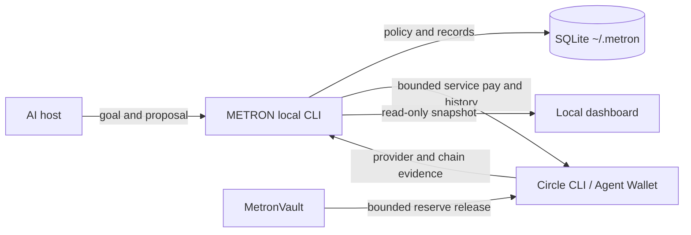

# METRON

**An economic control layer for AI agents.** METRON gives a host agent a revenue goal and bounded operating budget, then records payment evidence and deterministic double-entry accounting in local SQLite.

> An agent should earn the right to spend more capital by proving that previous spending generated revenue.

METRON is a skill-first plugin for Codex and compatible local AI hosts. The host supplies reasoning, search, browser, and email connections. METRON supplies local economic state and policy. It does not host an LLM, email integration, MCP server, or remote backend.



## Current verification

Local validation includes Python compilation, isolated CLI initialization/status, manifest JSON parsing, manual payment-rail smoke verification, and 13 Foundry tests. The local marketplace plugin was installed with Codex CLI 0.160.0 and invoked in fresh sessions: status, creation of a 2,000 USDC goal with a 20 USDC budget, then status again from the same isolated SQLite state. A synthetic manual loop verified bounded spending, invoice payment reconciliation, balanced journals, and reinvested capital increasing the next spend budget. Circle CLI 1.1.4 matches the npm registry latest; its Windows Node 22.23.1 runtime now passes read-only testnet preflight. Circle Terms are never inferred from METRON use; see [Circle setup](docs/INSTALL.md#circle-setup) for the one-time explicit consent flow. One Arc Testnet wallet is authenticated, but its live USDC balance is 0 and its transaction history currently has 0 records. METRON's local operating-wallet binding is not configured, so incoming reconciliation still requires the user to configure the intended wallet and provide confirmed incoming USDC evidence. No compatible Arc Testnet marketplace provider was found, so paid x402 execution remains skipped. Authoritative live Gateway reconciliation, deployment, and desktop-app plugin verification remain unverified. The current data practices are documented in [the privacy policy](docs/PRIVACY.md) and [security boundaries](docs/SECURITY.md); publish a public policy URL before directory submission. Synthetic fixtures do not prove live-provider behavior; testnet and synthetic records must remain labeled as such.

## Local quickstart

Requirements: Python 3.11+, Circle CLI for provider operations, and Foundry for contract build/tests.

```sh
python3 -B skills/metron/scripts/run.py init
python3 -B skills/metron/scripts/run.py status
```

Create a goal from a JSON file (amounts are exact USDC decimal strings):

```json
{
  "revenue_target": "2000",
  "policy": {
    "operating_budget": "20",
    "max_spend_per_action": "0.10",
    "max_daily_spend": "2",
    "reserve_floor": "10",
    "minimum_expected_roi_bps": 50000,
    "reinvestment_bps": 1000,
    "minimum_deal": "450"
  }
}
```

```sh
python3 -B skills/metron/scripts/run.py goal-create --input goal.json
```

All runtime state is stored under `~/.metron/`, outside the plugin source/cache. The read-only dashboard is generated at `~/.metron/dashboard.html` and shows the active goal, recorded journal balances, spending and daily authorization limits, deal and approval counts, and latest records including open invoices.

## Plugin install

Add this repository's `.agents/plugins/marketplace.json` as a local marketplace in a supported Codex client, install METRON, then start a fresh session and ask “Use METRON. Show status.” The local marketplace install and persisted state were verified in three fresh Codex CLI sessions; desktop-app plugin UI verification remains open.

## Accounting semantics

A Circle transaction is evidence. A Payment Entry is the business payment. A Journal Entry is its accounting consequence. METRON does not mark an invoice paid from a pasted hash or a submission response. Incoming USDC must be confirmed by Circle, match the open invoice and configured wallet, and be consumed only once.

The included MetronVault only controls reserve tokens still held in the contract. Once funds are released to the Circle Agent Wallet, the vault cannot control those funds. Local policy is deterministic but runs on the local machine.

## Scope and limitations

- Circle Agent Wallet and Circle CLI are the only implemented payment provider.
- Paid-service execution supports `exact` and `GatewayWalletBatched` x402 on Arc Testnet. Gateway transfers are recorded only after Circle's authoritative transfer API reports `confirmed` or `completed`.
- Circle CLI automatically prefers a Gateway-batched option when the seller and Gateway balance support it. METRON records the rail returned by Circle and reconciles it through the matching authoritative source; a rail mismatch remains `UNKNOWN` and is never retried automatically.
- The default chain is `ARC-TESTNET`; change it only through an explicit local configuration step after verifying the target chain.
- OTP login, testnet service payment, vault funding, deployment, and customer outreach require external account or user actions.
- Testnet transaction evidence does not prove mainnet readiness or business truth.
- METRON has no bundled email, hosted service, agent, scheduler, dashboard write controls, or arbitrary contract executor.

See [installation](docs/INSTALL.md), [privacy policy](docs/PRIVACY.md), [security boundaries](docs/SECURITY.md), [architecture](docs/ARCHITECTURE.md), and [demo flow](docs/DEMO.md).
